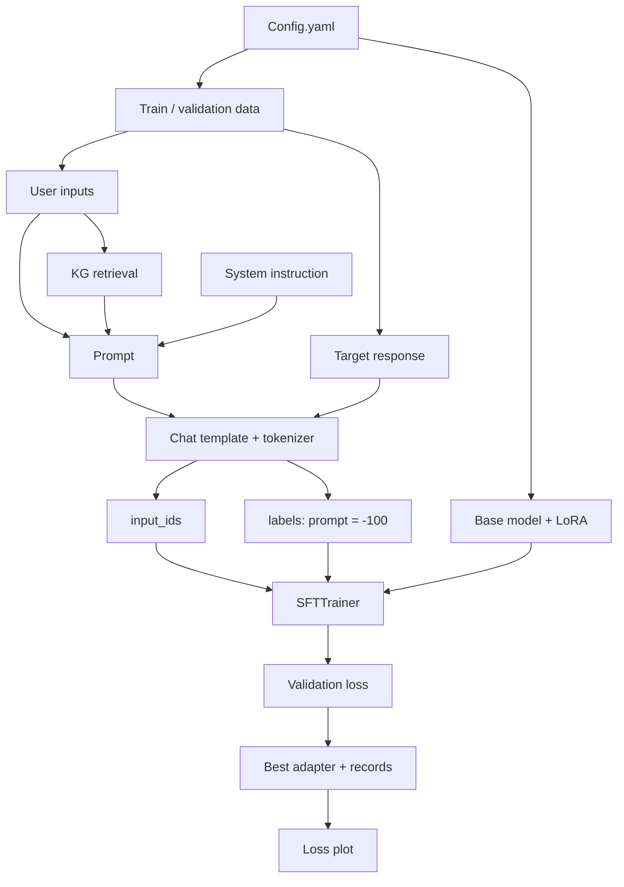

# SFT Progress Report

## 1. Current progress

The core supervised fine-tuning pipeline has been implemented, covering dataset splitting, training data preparation, model training, and the saving of training results. The model input combines system instructions, user input, case context, and retrieved KG context into a single prompt, while the model is trained to generate the structured output defined in `target_response`. After training, the pipeline saves the trained LoRA adapter along with the training records and results. The current experiments use a synthetic dummy dataset and a placeholder KG retriever that returns empty context.

| Component                                        |     Current state     |
| :----------------------------------------------- | :-------------------: |
| Shared configuration and model selection         |      Implemented      |
| Train/validation loading and prompt construction |      Implemented      |
| KG retrieval interface                           | Partially Implemented |
| Assistant-only label masking                     |      Implemented      |
| LoRA/QLoRA training and best-checkpoint saving   |      Implemented      |
| Experiment inspection and loss plotting          |      Implemented      |

## 2. Files

Paths below are relative to the repository root.

| Files                              | Main responsibility                                          |
| ---------------------------------- | ------------------------------------------------------------ |
| `configs/sft/training_config.yaml` | Configures models, datasets, training parameters, and output locations |
| `sft/data_preparation.py`          | Loads scenarios and prepares prompt/completion pairs         |
| `sft/retriever.py`                 | Defines the KG retrieval interface and its current empty implementation |
| `sft/prompting.py`                 | Combines system instructions, user input, case context, and retrieved context into prompts |
| `sft/trainer.py`                   | Tokenizes examples, masks labels, runs LoRA/QLoRA training, and saves the best adapter |
| `sft/plot_training_loss.py`        | Plots recorded training and validation loss                  |
| `data/sft/train_dummy.json`        | Synthetic dummy training data                                |
| `data/sft/validation_dummy.json`   | Synthetic dummy validation data                              |

## 3. Fine-tuning architecture



Training and validation data are prepared according to the configuration file. For each sample, the system instructions, user input, and retrieved KG context are combined to construct the model prompt, while `target_response` serves as the supervision target. After tokenization, prompt tokens are masked with `-100` to ensure that the loss is computed only on the assistant response. The base model is then fine-tuned using LoRA, and the best adapter is selected based on validation loss. Finally, the training records are saved for further analysis and loss visualization.

## 4. Raw data and retrieval

### **A training example:**

```json
{
  "schema_version": "0.1.0",
  "scenario_id": "SCN-DUMMY-TRN-000143",
  "family_id": "SCN-FAMILY-DUMMY-TRN-000143",
  "origin": "dummy_generated",
  "language": "en",
  "region_id": "region:us_missouri_bootheel",
  "input": {
    "user_text": "At the heading stage, the crop has hopper-burn-like yellowing with insects above the water line in two expanding patches. The problem became noticeable 14 days ago following alternating rain and sunshine. No lodging has been observed.",
    "growth_stage_id": "growth_stage:heading",
    "production_system_id": "production_system:direct_seeded_flooded",
    "cultivar_id": null
  },
  "annotations": {
    "observations": [
      {"concept_id": "symptom:hopper_burn", "state": "PRESENT"},
      {"concept_id": "field_pattern:patchy", "state": "PRESENT"},
      {"concept_id": "condition:alternating_rain_sun", "state": "PRESENT"},
      {"concept_id": "condition:lodging", "state": "ABSENT"},
      {"concept_id": "feature:brown_insects_at_stem_base", "state": "PRESENT"},
      {"concept_id": "evidence:independent_confirmation", "state": "UNKNOWN"}
    ],
    "acceptable_differential": ["pest:brown_planthopper", "disorder:drought_stress", "disease:rice_tungro"],
    "required_confounders": ["disorder:drought_stress", "disease:rice_tungro"],
    "correct_first_behavior": "ANSWER",
    "required_questions": [],
    "escalation_required": false,
    "supporting_fact_ids": ["DUMMY-FACT-000011"],
    "supporting_source_ids": ["DUMMY-SRC-000011"]
  },
  "target_response": {
    "status": "provisional_assessment",
    "observations_needed": [],
    "differential": ["pest:brown_planthopper", "disorder:drought_stress", "disease:rice_tungro"],
    "actions": ["Inspect stem bases and confirm insect identity before control decisions."],
    "escalation_required": false,
    "grounding": ["DUMMY-FACT-000011"],
    "safety_flags": []
  }
}
```

### **Retrieval interface:**

```python
Retriever.retrieve_kg(self, public_case: PublicCase) -> RetrievedContext
```

`PublicCase` contains only `input`, `language`, and `region_id`. Within `input`, the allowlist is `user_text`, `growth_stage_id`, `production_system_id`, and `cultivar_id`.

The current function returns:

```json
{
  "observations": [],
  "candidates": [],
  "missing_checks": [],
  "graph_context": {},
  "evidence_fact_ids": [],
  "evidence_source_ids": []
}
```

The five list fields and one dictionary are the current interface. Observation/candidate item schemas are still open (`list[Any]`), while evidence IDs are `list[str]`. A real implementation can replace the method while keeping the prompt-building interface. `build_examples(scenarios, retriever=...)` also accepts a supplied retriever. The trainer currently uses the default `Retriever`.

## 5. Model input and output

This example uses `SCN-DUMMY-TRN-000143` and the saved Qwen3-4B tokenizer.

### Actual training input

The prepared prompt has two messages: `system` contains `SYSTEM_PROMPT` from `sft/prompting.py`; `user` contains the user input, case context, and retrieved context. The reference `target_response` is added as an `assistant` message during training.

The model receives integer token IDs. The following is their complete decoded text for this example, including Qwen3's chat markers:

```text
<|im_start|>system
You are a rice crop diagnostic assistant. Use the public case and retrieved context to choose a cautious first response. Output only one compact JSON object with exactly these fields: status, observations_needed, differential, actions, escalation_required, grounding, safety_flags. status must be needs_more_information, provisional_assessment, or escalation_required. observations_needed is a list of question IDs; differential is a list of cause IDs; actions and safety_flags are lists of strings; escalation_required is a boolean; grounding is a list of fact IDs. Ask for missing distinguishing observations instead of confirming a diagnosis prematurely. Use status escalation_required exactly when escalation_required is true. The retrieved context contains observations, candidates, missing_checks, graph_context, evidence_fact_ids, and evidence_source_ids. Do not include prose, Markdown, or reasoning outside JSON.<|im_end|>
<|im_start|>user
User query:
{
  "input": {
    "user_text": "At the heading stage, the crop has hopper-burn-like yellowing with insects above the water line in two expanding patches. The problem became noticeable 14 days ago following alternating rain and sunshine. No lodging has been observed.",
    "growth_stage_id": "growth_stage:heading",
    "production_system_id": "production_system:direct_seeded_flooded",
    "cultivar_id": null
  },
  "language": "en",
  "region_id": "region:us_missouri_bootheel"
}

retrieved context:
{
  "observations": [],
  "candidates": [],
  "missing_checks": [],
  "graph_context": {},
  "evidence_fact_ids": [],
  "evidence_source_ids": []
}<|im_end|>
<|im_start|>assistant
{"status":"provisional_assessment","observations_needed":[],"differential":["pest:brown_planthopper","disorder:drought_stress","disease:rice_tungro"],"actions":["Inspect stem bases and confirm insect identity before control decisions."],"escalation_required":false,"grounding":["DUMMY-FACT-000011"],"safety_flags":[]}<|im_end|>
```

After tokenization and collation, a batch containing this one example has:

| Tensor | Shape | Contents |
| --- | --- | --- |
| `input_ids` | `[1, 426]` | System/user prompt, assistant header, reference JSON, and chat ending |
| `attention_mask` | `[1, 426]` | All ones: this single-example batch needs no padding |
| `labels` | `[1, 426]` | First 346 positions are `-100`; remaining 80 hold target token IDs |

The sequence is 426 tokens long, rather than padded to the configured maximum of 512. The collator pads to the longest sequence in a batch and masks padding labels with `-100` when needed.

### Training labels and next-token prediction

```text
input_ids[:12] = [151644, 8948, 198, 2610, 525, 264, 19653, 19097, 15089, 17847, 13, 5443]
labels[:12]    = [-100, -100, -100, -100, -100, -100, -100, -100, -100, -100, -100, -100]

labels[:346] == [-100] * 346
labels[346:] == input_ids[346:]

First supervised tokens:
labels[346] = 4913   # token text: {"
labels[347] = 2829   # status
```

With zero-based positions and the causal shift, the hidden state at position 345 predicts token 4913 at position 346. After seeing that reference token, position 346 predicts token 2829 at position 347. The same process continues through the target JSON, `<|im_end|>`, and the final newline.

Only these 80 target positions contribute to the loss. Prompt positions still provide context even though their labels are `-100`. The trainer learns next-token predictions, rather than a separate classifier for each JSON field.

### Reference output the model is trained to produce

For this example, the expected assistant response is:

```json
{
  "status": "provisional_assessment",
  "observations_needed": [],
  "differential": [
    "pest:brown_planthopper",
    "disorder:drought_stress",
    "disease:rice_tungro"
  ],
  "actions": [
    "Inspect stem bases and confirm insect identity before control decisions."
  ],
  "escalation_required": false,
  "grounding": [
    "DUMMY-FACT-000011"
  ],
  "safety_flags": []
}
```

The completion is serialized compactly during training. The indentation here is for readability.

## 6. Model and training configuration

### Supported model registry

| Short name     | Base model                         | LoRA targets                      | Explicit chat-template setting |
| -------------- | ---------------------------------- | --------------------------------- | ------------------------------ |
| `qwen2.5-1.5b` | `Qwen/Qwen2.5-1.5B-Instruct`       | `q_proj`, `v_proj`                | Default                        |
| `qwen3-4b`     | `Qwen/Qwen3-4B-Instruct-2507`      | `q_proj`, `v_proj`                | Default                        |
| `phi4-mini`    | `microsoft/Phi-4-mini-instruct`    | `qkv_proj`                        | Default                        |
| `smollm3-3b`   | `HuggingFaceTB/SmolLM3-3B`         | `q_proj`, `v_proj`                | `enable_thinking: false`       |
| `qwen3.5-4b`   | `Qwen/Qwen3.5-4B`                  | `q_proj`, `v_proj`, `in_proj_qkv` | `enable_thinking: false`       |
| `llama3.2-3b`  | `meta-llama/Llama-3.2-3B-Instruct` | `q_proj`, `v_proj`                | Default                        |

Phi uses a fused QKV projection. Qwen3.5 targets both the listed full-attention projections and its fused linear-attention QKV projection. These choices follow different architectures, so trainable adapter coverage is not identical across models.

### Shared settings in the current configuration and saved runs

| Setting                                  | Value                                                        |
| ---------------------------------------- | ------------------------------------------------------------ |
| Maximum sequence length                  | 512 tokens, including prompt and completion                  |
| Epochs / seed                            | 3 / 42                                                       |
| Train / validation batch size per device | 1 / 1                                                        |
| Gradient accumulation                    | 8                                                            |
| Learning rate / scheduler                | `1e-4` / cosine                                              |
| Warmup                                   | `warmup_steps: 0.05`; the installed Transformers version treats values below 1 as a fraction, giving 4 warmup steps for 75 total steps |
| Weight decay / maximum gradient norm     | 0.01 / 1.0                                                   |
| Quantization                             | 4-bit NF4 with double quantization when CUDA is available    |
| LoRA                                     | Rank 16, alpha 32, dropout 0.05, bias `none`, causal LM task |
| Precision / optimizer in saved runs      | BF16 / `paged_adamw_8bit`                                    |
| Gradient checkpointing                   | Enabled with `use_reentrant=False`                           |
| Loss setup                               | Assistant-only labels; `completion_only_loss=True`; `packing=False` |
| Logging / validation / saving            | Every 5 / 10 / 10 optimizer steps; final validation recorded at step 75 |
| Checkpoint selection                     | Lowest validation loss; best model loaded at training end    |
| Checkpoint retention                     | `save_total_limit: 2`                                        |

With 200 examples, batch size 1, and accumulation 8, each epoch has 25 optimizer steps. Three epochs therefore produce the observed 75 steps. Validation uses the same preparation, retriever stub, tokenizer, and label masking as training, without parameter updates.

## 7. Completed experiments and saved files

All six runs completed 3 epochs and 75 optimizer steps using 200 training and 50 validation examples. Values below are read from each run's `train_results.json` and `trainer_state.json`; they are not a new training run.

| Model short name | Overall train loss | Best validation loss | Best step | Final validation loss, step 75 |
| ---------------- | -----------------: | -------------------: | --------: | -----------------------------: |
| `qwen2.5-1.5b`   |           1.277790 |             0.865218 |        70 |                       0.866543 |
| `qwen3-4b`       |           0.982117 |             0.457665 |        75 |                       0.457665 |
| `phi4-mini`      |           0.989615 |             0.471717 |        70 |                       0.471947 |
| `smollm3-3b`     |           0.957035 |             0.519606 |        70 |                       0.519919 |
| `qwen3.5-4b`     |           0.552940 |             0.135133 |        70 |                       0.135311 |
| `llama3.2-3b`    |           0.912247 |             0.419131 |        75 |                       0.419131 |

Overall train loss averages the run, whereas validation loss is measured at a checkpoint. Best-checkpoint selection uses validation loss, so the best step need not have the highest token accuracy. The first recorded validation point is step 10; there is no untrained step-0 measurement. Different tokenizers, templates, and adapter coverage limit direct comparisons between models. These results establish that the training pipeline runs and learns the reference-token task on dummy data.

For example, `outputs/sft/qwen3-4b_ep3_lr1e-4_seed42/` contains the saved training artifacts below. Plots and background-control files are conditional additions:

| Files                                              | Meaning                                                      |
| -------------------------------------------------- | ------------------------------------------------------------ |
| `sample_preview.json`                              | Summary and one prepared example from each split; includes tokenization statistics for a training run |
| `run_config.json`                                  | Resolved configuration, including the selected model, adapter targets, dataset paths, and output settings |
| `adapter_model.safetensors`, `adapter_config.json` | Saved LoRA weights and configuration; these are adapters, not a standalone merged base model |
| Tokenizer files and `chat_template.jinja`          | Tokenizer/template saved for consistent subsequent use       |
| `trainer_state.json`                               | Global step, best checkpoint, and logged training/validation measurements |
| `train_results.json`, `all_results.json`           | Saved training summary metrics                               |
| `checkpoint-70/`, `checkpoint-75/`                 | Retained checkpoint artifacts                                |
| `training_args.bin`                                | Serialized Trainer arguments                                 |
| `training_loss.png`                                | Optional plot created separately by the plotting command; not automatically produced by the trainer |
| `train.log`, `train.pid`                           | Background-run console log and startup PID, when launched with `--background` |

Because `load_best_model_at_end=True`, the adapter saved at the experiment root represents the selected best checkpoint, even when training continued to step 75.
