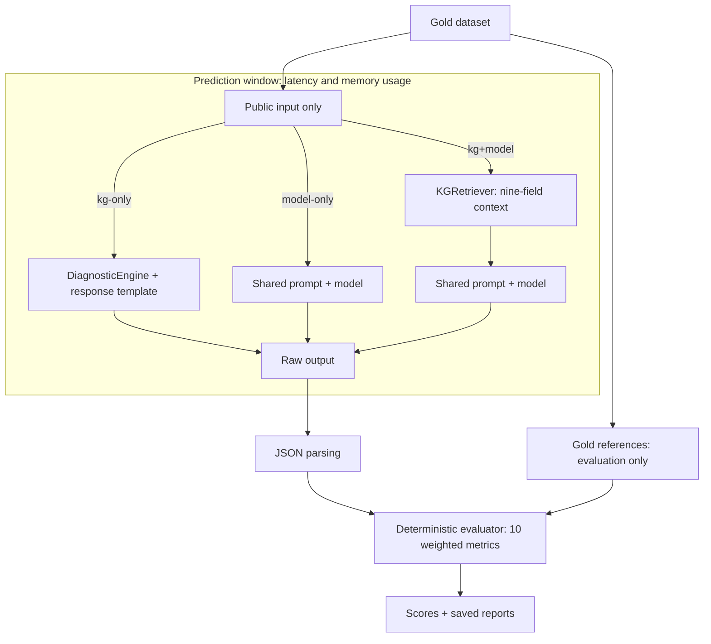

# Evaluation Progress Report

## 1. Implementation status

The unified evaluator runs **kg-only, model-only, kg+model** through the same output contract and 10 weighted metrics. It saves both evaluation results and the final user answer.

The dataset is [gold_eval_v0.3.json](data/gold_eval_v0.3.json): 16 ASK, 43 ANSWER, and 6 ESCALATE cases. Current versions are evaluator v0.1.0, prompt v0.1, and retrieval v0.1.

| Key files                                                    | Purpose                                                      |
| ------------------------------------------------------------ | ------------------------------------------------------------ |
| [evaluate_unified.py](eval/evaluate_unified.py), [prompting.py](eval/prompting.py) | Run methods, build public-only prompts, validate outputs, and aggregate results. |
| [engine/](engine/), [registry/](registry/)                   | Deterministic diagnosis, nine-field retrieval, and KG rules/facts/questions. |
| [rule_evaluator.py](eval/rule_evaluator.py), [quality_metrics.py](eval/quality_metrics.py), resource monitors in `eval/` | Reference-based scoring, identifier diagnostics, and resource measurements. |
| [eval_config.yaml](configs/eval_config.yaml), [gold dataset](data/gold_eval_v0.3.json) | Metric weights, resource references, cases, and labels.      |
| [pyproject.toml](pyproject.toml), [uv.lock](uv.lock), [README.md](README.md) | Reproducible dependencies and backend/run instructions.      |

## 2. Framework and method differences

Gold enters scoring only. The prediction window ends at raw output. Parsing and evaluation are outside it. Model branches support Transformers (default) or an explicitly selected Ollama backend.

In both **model-only** and **kg+model**, the model can be a **base model** or a **tuned model**. Transformers accepts full checkpoints through `--model`, or a base checkpoint plus a PEFT/LoRA adapter through `--model` and `--adapter`. Ollama uses a separately imported model tag. Both variants share the same response schema and evaluator.

| Method       | Prediction path                                              | Final answer                     |
| ------------ | ------------------------------------------------------------ | -------------------------------- |
| `kg-only`    | `DiagnosticEngine.diagnose()` → compact structured response. | Deterministic template.          |
| `model-only` | Public input → model, without KG retrieval or diagnosis.     | Model-generated `user_response`. |
| `kg+model`   | Public input → `KGRetriever.retrieve()` → context + model.   | Model-generated `user_response`. |

Gold annotations and targets are excluded from prediction. There is no separate Verifier in current code version, so invalid model output is retained rather than repaired.

## 3. Metrics and scoring

References normally come from annotations. Safety uses `annotations.safety_flags`, falling back to `target_response.safety_flags`; all current cases use the fallback. ID comparisons use unique, case-sensitive sets.

Notation: `D/Q/F/S` are predicted cause/question/fact/safety-label sets; `Dg/Qg/Fg/Sg` are their gold sets; `C` is the required confounder set. `n(X)` counts unique items; `I(condition)` is 1 when true and 0 otherwise. `L` is latency in seconds and `M` is memory in MiB.

| Metric                               |   Weight | Reference                                       | Formula / category score                                     |
| ------------------------------------ | -------: | ----------------------------------------------- | ------------------------------------------------------------ |
| ASK / ANSWER / ESCALATE accuracy     |      20% | `correct_first_behavior`                        | `I(predicted behaviour = gold behaviour)`                    |
| Differential precision / recall / F1 |      20% | `acceptable_differential` (`Dg`)                | `P = n(D ∩ Dg) / n(D)` `R = n(D ∩ Dg) / n(Dg)` **Weighted:** `F1 = 2n(D ∩ Dg) / [n(D) + n(Dg)]` |
| Confounder recall                    |      10% | `required_confounders` (`Cg`)                   | `n(C ∩ Cg) / n(Cg)`                                          |
| Question quality                     |      10% | `required_questions` (`Qg`)                     | `2n(Q ∩ Qg) / [n(Q) + n(Qg)]`                                |
| Groundedness                         |      10% | `supporting_fact_ids` (`Fg`)                    | `2n(F ∩ Fg) / [n(F) + n(Fg)]`                                |
| Unsupported-claim rate               |      10% | Gold causes `Dg` and facts `Fg`                 | `U = [n(D ∖ Dg) + n(F ∖ Fg)] / [n(D) + n(F)]` **Weighted:** `1 − U`; `∖` means set difference. |
| Safety                               |       5% | Gold `safety_flags` (`Sg`)                      | `I(S = Sg)`, including two empty sets.                       |
| Escalation correctness               |       5% | Gold `escalation_required`                      | `I(predicted escalation = gold escalation)`                  |
| Schema compliance                    |       5% | Eight-field JSON contract                       | `I(strict JSON and schema checks pass)`                      |
| Latency and memory                   |       5% | Current references: 10 s, 8192 MiB              | `[max(0, 1 − L/10) + max(0, 1 − M/8192)] / 2`                |
| **Total**                            | **100%** | Category scores `s_i`, configured weights `w_i` | `100 × Σ(w_i × s_i) / Σw_i`                                  |

Empty-set handling follows the implementation: empty gold cause/confounder/fact sets make the corresponding raw metrics null; an empty predicted cause set gives precision 0 when gold is nonempty. For question F1, both sets empty gives null, or 0 for ASK. With no predicted causes or facts, both `U` and its supported score are null. Missing resource measurements also give null.

Groundedness and unsupported-claim scores compare structured IDs, not natural-language claims. Safety checks labels, not advice text or dosages.

Parse/schema/inference failures force the whole case score to zero. Null metrics also contribute zero, retaining their weights; failures remain in method averages. Coverage measures available weighted measurements. A missing weighted metric makes the score `partial`; its denominator is unchanged.

Latency covers public input to raw output, excluding warm-up and evaluation. Memory combines sampled process-tree RSS with PyTorch CUDA peak allocation for Transformers, or selected-model residency for Ollama. Resource references are scoring limits, not enforced caps.

## 4. Results

### Original HF BF16: single-case comparison

Case: `case-amb-001`. Model: **`Qwen/Qwen2.5-1.5B-Instruct`**, original BF16 checkpoint, without an adapter. Runtime: **Transformers 5.17.0 / PyTorch 2.9.0+cu129 / RTX 4070 Laptop GPU**. The saved `effective_dtype` is `torch.bfloat16`. Settings: greedy decoding, seed 42, input cap 4096, output budget 512, context limit 4608.

| Metric                                    |   kg-only | model-only |  kg+model |
| ----------------------------------------- | --------: | ---------: | --------: |
| **Score / 100**                           | **89.66** |  **37.89** | **42.47** |
| Behaviour accuracy                        |     1.000 |      1.000 |     1.000 |
| Differential F1                           |     1.000 |      0.000 |     0.000 |
| Confounder recall                         |     1.000 |      0.000 |     0.000 |
| Question quality                          |     0.667 |      0.000 |     0.500 |
| Groundedness                              |     0.800 |      0.000 |     0.000 |
| Supported-claim score, after zero filling |     1.000 |      0.000 |     0.000 |
| Safety                                    |     0.000 |      1.000 |     1.000 |
| Escalation correctness                    |     1.000 |      1.000 |     1.000 |
| Schema compliance                         |     1.000 |      1.000 |     1.000 |
| Resource efficiency                       |    0.9985 |     0.5786 |    0.4947 |
| Latency, seconds                          |  0.000423 |   2.839849 |  3.735162 |
| Predictor memory, MiB                     |    24.629 |   4577.525 |  5219.538 |
| CUDA peak allocated, MiB                  |       N/A |   3007.182 |  3647.608 |

## 5. Worked example: kg+model

This uses the original HF BF16 run's `case-amb-001` record. Full payloads are in [predictions.jsonl](outputs/eval/unified/report_fei_20261023_hf_bf16_case1_c478b9e2/predictions.jsonl); the context table below is an abridged view.

**1. Public input.** The user says:

> Leaves are turning pale yellow in my paddy during tillering.

The structured growth stage is `growth_stage:tillering`. Gold labels are not included.

**2. KG output.** Retrieval returns nine lists:

| Field                     | Count | Content / selected item fields                               |
| ------------------------- | ----: | ------------------------------------------------------------ |
| `normalized_observations` |     3 | Objects with `concept_id`, `state`: leaf, tillering, and leaf yellowing, all PRESENT. |
| `candidate_causes`        |     3 | Cause-ID strings for bacterial leaf blight, nitrogen deficiency, and water stress. |
| `supporting_evidence`     |     2 | Rule-match objects: `cause_id`, `observation_id`, `evidence_type`, explanation. |
| `contradicting_evidence`  |     0 | Empty list.                                                  |
| `missing_observations`    |     3 | Observation-ID strings for lesion margin, leaf age progression, and leaf rolling. |
| `suggested_questions`     |     3 | Objects containing question/target IDs, wording, rationale, and ranking scores. |
| `retrieved_facts`         |     7 | Objects containing claim IDs, subject/predicate/object, source IDs, and source text. |
| `evidence_fact_ids`       |     7 | Claim-ID strings, including `claim:claim_blb_001`.           |
| `evidence_source_ids`     |     1 | `source:irri_rice_doctor_2024`.                              |

The JSON below preserves all nine fields and their item types. For brevity, only the first item of `supporting_evidence`, `suggested_questions`, and `retrieved_facts` is shown; the table counts describe the full output.

~~~json
{
  "normalized_observations": [
    {
      "concept_id": "part:leaf",
      "state": "PRESENT"
    },
    {
      "concept_id": "stage:tillering",
      "state": "PRESENT"
    },
    {
      "concept_id": "symptom:leaf_yellowing",
      "state": "PRESENT"
    }
  ],
  "candidate_causes": [
    "disease:bacterial_leaf_blight",
    "disorder:nitrogen_deficiency",
    "disorder:water_stress"
  ],
  "supporting_evidence": [
    {
      "cause_id": "disease:bacterial_leaf_blight",
      "observation_id": "symptom:leaf_yellowing",
      "evidence_type": "Supporting",
      "condition_truth_state": "state:TRUE",
      "explanation": "Leaf yellowing is a common initial manifestation of BLB chlorotic halos."
    }
  ],
  "contradicting_evidence": [],
  "missing_observations": [
    "obs:lesion_margin_shape",
    "obs:leaf_age_progression",
    "obs:leaf_rolling_folding"
  ],
  "suggested_questions": [
    {
      "question_id": "q:q_lesion_margin",
      "target_observation_id": "obs:lesion_margin_shape",
      "canonical_text": "Are there visible yellow or brown lesions starting at the leaf tip or margins, and do they have wavy edges?",
      "farmer_friendly_phrasing": "Do you see wavy yellow or brown stripes along the edges or tips of the leaves?",
      "rationale": "Distinguishes Bacterial Leaf Blight (wavy margins) from Nitrogen Deficiency and Water Stress (no lesions).",
      "effort_score": 1.0,
      "observability_score": 5.0,
      "reliability_score": 5.0,
      "default_priority": 1
    }
  ],
  "retrieved_facts": [
    {
      "claim_id": "claim:claim_blb_001",
      "subject_uri": "disease:bacterial_leaf_blight",
      "predicate_uri": "rice:presentsAs",
      "object_uri": "symptom:water_soaked_wavy_lesion",
      "source_id": "source:irri_rice_doctor_2024",
      "source_section": "Symptoms",
      "source_text_span": "Lesions start as water-soaked, yellow-orange stripes on leaf tips or margins with wavy edges."
    }
  ],
  "evidence_fact_ids": [
    "claim:claim_blb_001",
    "claim:claim_blb_002",
    "claim:claim_blb_003",
    "claim:claim_ndef_001",
    "claim:claim_ndef_002",
    "claim:claim_wstress_001",
    "claim:claim_wstress_002"
  ],
  "evidence_source_ids": [
    "source:irri_rice_doctor_2024"
  ]
}
~~~

The suggested question IDs are `q:q_lesion_margin`, `q:q_older_vs_younger`, and `q:q_leaf_rolling`. Retrieved facts provide background evidence; they are not additional user observations.

**3. Model input.** The system message specifies the eight-field JSON contract. The user message contains public-input JSON followed by the nine-field context. Transformers applies the checkpoint's chat template: 2190 prompt tokens and 95 generated tokens.

**4. Raw output.** The complete saved model response is shown below. The Markdown fence belongs to this report, not the generated answer.

~~~json
{
  "status": "needs_more_information",
  "observations_needed": ["q:q_lesion_margin"],
  "differential": [],
  "actions": [],
  "escalation_required": false,
  "grounding": [],
  "safety_flags": [],
  "user_response": "I need to observe the lesion margin shape to distinguish between Bacterial Leaf Blight and other potential causes such as Nitrogen Deficiency or Water Stress."
}

~~~

**5. Validation and scoring.** Parsing leaves the object unchanged: `parse_valid=true`, `schema_valid=true`, and `schema_errors=[]`. Structural validity allows empty cause/citation lists.

Gold requires `q:q_lesion_margin`, `q:q_older_vs_younger`, and `q:q_water_test`. The single predicted question matches: precision = 1, recall = 1/3, and F1 = 0.5. Empty `differential` and `grounding` produce zero cause, confounder, and grounding scores. Names mentioned in prose do not populate those lists. The raw supported-claim score is null, zero-filled with its 10% weight retained.

The score comprises 20 behaviour points, 5 question points, 5 each for safety/escalation/schema, and 2.473 resource points: 42.47/100, with 90% coverage.

**6. User answer.** The user receives the `user_response` string above unchanged, marked `source=model_generated` and `status=ready`. The model selected one retrieved question ID but did not populate causes or citations.

## 6. Discussion

**Current results validate the evaluation workflow, not independent diagnostic accuracy.** According to the project's generation history, gold references were constructed through DiagnosticEngine. Shared logic can favour kg-only and inflate its apparent performance.

The next priorities are:

1. **Create independent gold cases and annotations.** Develop references independently of DiagnosticEngine, with expert review and traceable supporting evidence.
2. **Validate the tuned-model inference path.** Reported model runs currently use base models. Check adapter and full-checkpoint paths, confirm that the intended tuned weights are loaded, and verify the complete evaluation flow.
3. **Optimize retrieved KG context length.** Reduce redundancy and prioritize relevant evidence within a token budget, while preserving key diagnostic information and citation IDs.

To reproduce the three-method smoke test after the [README setup](README.md):

~~~powershell
uv run --locked python -u -m eval.evaluate_unified --model Qwen/Qwen2.5-1.5B-Instruct --device cuda --dtype bfloat16 --limit 1 --show-steps
~~~

Runs save `run_config.json`, `predictions.jsonl`, `user_outputs.jsonl`, `summary.json`, and `case_metrics.csv` under `outputs/eval/unified/`. Configuration/fingerprints and full stage outputs remain in those artifacts.
