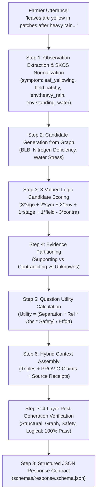

# Step 15: End-to-End Knowledge Graph & Model Integration Pipeline (Phase 10)

**Project:** Rice Pathogen Small Agriculture Language Model (SALM)  
**Workstream:** Reasoning Engine & Pipeline Integration  
**Focus:** Response to Manager Feedback on End-to-End Diagnostic Pipeline Integration

---

## 1. Executive Summary & Manager Feedback Alignment

In response to leadership guidance (*"We need to build Integration rather than adding more information"*), Step 15 demonstrates the **Phase 10 Knowledge Graph and Model Integration Architecture** (Sections 14.1 through 14.10 of the implementation blueprint).

This pipeline takes the canonical field scenario:
> **"the rice leaves are yellow in patches after heavy rain and standing water"**

and executes the complete 8-step reasoning trace, making every intermediate transformation mathematically transparent and verifiable.



---

## 2. Step-by-Step Pipeline Execution Breakdown

### Step 1: Observation Extraction & SKOS Normalization (14.1 & 14.2)
Free-text farmer phrasing is extracted into token spans and mapped into canonical W3C SKOS concept URIs with 3-Valued Logic states:

| Source Token Span | Canonical Term ID | SKOS Preferred Label | Entity Class | 3VL State |
| :--- | :--- | :--- | :--- | :---: |
| `"yellow"` | `symptom:leaf_yellowing` | Leaf yellowing | Symptom | `state:TRUE` |
| `"in patches"` | `field:patchy_distribution` | Patchy field distribution | FieldDistribution | `state:TRUE` |
| `"after heavy rain"` | `env:heavy_rainfall` | Heavy rainfall | EnvironmentalCondition | `state:TRUE` |
| `"standing water"` | `env:standing_water` | Standing water | EnvironmentalCondition | `state:TRUE` |
| `"leaves"` | `part:leaf` | Leaf blade | PlantPart | `state:TRUE` |
| `context.growth_stage` | `stage:tillering` | Tillering stage | GrowthStage | `state:TRUE` |

---

### Step 2: Knowledge Graph Candidate Condition Generation (14.3)
Ontology traversal over `rice-pathogen-v0.1.ttl` and `disease-registry.csv` identifies all candidate conditions matching leaf chlorosis, vegetative growth, and moisture drivers:

1. **`disease:bacterial_leaf_blight` (Bacterial Leaf Blight - BLB):**
   - *Causal Pathogen:* *Xanthomonas oryzae* pv. *oryzae*
   - *Category:* Infectious Vascular Pathogen
   - *Linked Diagnostic Contrasts:* `contrast:blb_vs_nitrogen_deficiency`, `contrast:blb_vs_water_stress`
2. **`disorder:nitrogen_deficiency` (Nitrogen Deficiency):**
   - *Category:* Abiotic Nutrient Disorder (Primary Look-Alike Confounder)
   - *Linked Diagnostic Contrasts:* `contrast:blb_vs_nitrogen_deficiency`
3. **`disorder:water_stress` (Water-Related Stress):**
   - *Category:* Abiotic Moisture Stress
   - *Linked Diagnostic Contrasts:* `contrast:blb_vs_water_stress`

---

### Step 3: 3-Valued Logic (3VL) Candidate Scoring Matrix (10.1 & Section 10)
Under the Open World Assumption, unmentioned traits remain `UNKNOWN` (neutral 0) rather than assumed false. 

$$	ext{Score} = 3 	imes 	ext{sign} + 2 	imes 	ext{symptom} + 2 	imes 	ext{env} + 1 	imes 	ext{stage} + 1 	imes 	ext{field} - 3 	imes 	ext{contradiction}$$

| Candidate Cause | Arithmetic Computation | Total Score | Confidence | Diagnostic Status |
| :--- | :--- | :---: | :---: | :--- |
| **Bacterial Leaf Blight** | $(2 	imes 1) + (2 	imes 2) + (1 	imes 1) + (1 	imes 1) - 0 = \mathbf{2 + 4 + 1 + 1}$ | **+8** | **HIGH** | Leading Primary Candidate |
| **Nitrogen Deficiency** | $(2 	imes 1) + (1 	imes 1) - (3 	imes 1) = \mathbf{2 + 1 - 3}$ | **0** | **LOW** | Demoted by Patchy Pattern |
| **Water-Related Stress** | $(2 	imes 1) + (1 	imes 1) = \mathbf{2 + 1}$ | **+3** | **MEDIUM** | Retained Secondary Confounder |

---

### Step 4: Evidence Partitioning (Supporting vs Contradicting vs Unknown) (Step 9 / Section 14.8.4)

- **Bacterial Leaf Blight (`disease:bacterial_leaf_blight`):**
  - **Supporting:** `symptom:leaf_yellowing` (chlorosis match), `env:heavy_rainfall` (dispersal driver), `env:standing_water` (entry driver), `field:patchy_distribution` (cluster infection), `stage:tillering` (susceptible phenology).
  - **Contradicting:** None (zero contradictions).
  - **Missing (Unknowns):** `obs:lesion_margin_shape` (check wavy margin), `obs:bacterial_ooze_test` (check cut-leaf streaming).
- **Nitrogen Deficiency (`disorder:nitrogen_deficiency`):**
  - **Supporting:** `symptom:leaf_yellowing`, `stage:tillering`.
  - **Contradicting:** `field:patchy_distribution` (**-3 Penalty:** Nitrogen deficiency is soil-fertility mediated and requires uniform whole-field chlorosis).
  - **Missing (Unknowns):** `obs:leaf_age_progression` (check if lowest/oldest leaves chlorose first).

---

### Step 5: Unknowns & Mathematical Question Utility Selection (14.4 & Step 7)
When uncertainty remains (differential spread $\ge 2$ but definitive physical signs unobserved), the engine calculates the utility of every distinguishing question:

$$	ext{Utility} = rac{	ext{Separation} 	imes 	ext{Reliability} 	imes 	ext{Observability} 	imes 	ext{Safety}}{	ext{User Effort}}$$

| Rank | Question ID | Target Observation | Formula Arithmetic | Utility | Action |
| :---: | :--- | :--- | :---: | :---: | :--- |
| **#1** | **`q:q_lesion_margin`** | `obs:lesion_margin_shape` | $rac{3 	imes 5.0 	imes 5.0 	imes 1.0}{1.0}$ | **75.0** | **Selected as Top-1 Question to Ask Farmer** |
| **#2** | **`q:q_older_vs_younger`** | `obs:leaf_age_progression` | $rac{3 	imes 5.0 	imes 5.0 	imes 1.0}{1.0}$ | **75.0** | Selected as Top-2 Clarifying Question |
| **#3** | **`q:q_leaf_rolling`** | `obs:leaf_rolling_folding` | $rac{2 	imes 5.0 	imes 5.0 	imes 1.0}{1.0}$ | **50.0** | Secondary Question |
| **#4** | **`q:q_water_test`** | `obs:bacterial_ooze_test` | $rac{3 	imes 5.0 	imes 4.0 	imes 1.0}{2.0}$ | **30.0** | High-Value Definitive Sign Field Test |

**Top Selected Clarifying Question:**  
> *"Are there visible yellow or brown lesions starting at the leaf tip or margins, and do they have wavy edges?"*

---

### Step 6: Hybrid Context Assembly & Grounding (14.5 & 14.6)
The Small Language Model (SLM) prompt is assembled using verified graph subgraphs and verbatim literature text spans:
- `disease:bacterial_leaf_blight rice:presentsAs symptom:leaf_yellowing`
- `disease:bacterial_leaf_blight rice:favoredBy env:standing_water`
- `disease:bacterial_leaf_blight rice:favoredBy env:heavy_rainfall`
- `disease:bacterial_leaf_blight rice:hasFieldDistribution field:patchy_distribution`
- `contrast:blb_vs_nitrogen_deficiency rice:differentiatedBy obs:lesion_margin_shape`
- `claim:claim_blb_001`: *"Lesions start as water-soaked, yellow-orange stripes on leaf tips or margins with wavy edges."* (IRRI Rice Doctor 2024 | SME: Richard Lindsay [Approved])

---

### Step 7: 4-Layer Post-Generation Verification (14.8)
All outputs pass strict automated verification:
- **Structural Check (14.8.1):** `PASS` (Valid JSON conforming to `schemas/response.schema.json`).
- **Graph Check (14.8.2):** `PASS` (All entity IDs verified against canonical CSV registries).
- **Safety Check (14.8.3):** `PASS` (Zero chemical brand names, zero volumetric dosages).
- **Logical Check (14.8.4):** `PASS` (Zero overlap between supporting and contradicting sets).

---

### Step 8: Final JSON Response Contract Output
```json
{
  "case_id": "case-mgr-demo-001",
  "status": "needs_more_information",
  "normalized_observations": {
    "growth_stage": "tillering",
    "affected_part": ["part:leaf"],
    "symptoms": ["symptom:leaf_yellowing"],
    "distribution": "field:patchy_distribution",
    "recent_conditions": ["env:standing_water", "env:heavy_rainfall"],
    "region": "priority-region-1"
  },
  "observations_needed": [
    {
      "question_id": "q:q_lesion_margin",
      "question": "Are there visible yellow or brown lesions starting at the leaf tip or margins, and do they have wavy edges?",
      "reason": "Distinguishes BLB (wavy margins) from Nitrogen Deficiency and Water Stress (no lesions).",
      "priority": 1
    }
  ],
  "differential": [
    {
      "cause_id": "disease:bacterial_leaf_blight",
      "display_name": "Bacterial leaf blight",
      "cause_type": "pathogen",
      "score": 8,
      "confidence_band": "high",
      "supporting_observations": [
        "symptom:leaf_yellowing",
        "env:heavy_rainfall",
        "env:standing_water",
        "stage:tillering",
        "field:patchy_distribution"
      ],
      "contradicting_observations": [],
      "missing_distinguishing_observations": [
        "obs:lesion_margin_shape",
        "obs:bacterial_ooze_test"
      ],
      "distinguishing_checks": [
        "Check lesion margin shape (wavy vs no lesions)",
        "Inspect whether lowest leaves chlorose first",
        "Perform cut-leaf streaming test in clear water"
      ],
      "rank": 1
    }
  ],
  "recommended_actions": [
    {
      "action_id": "action:avoid_excess_nitrogen",
      "priority": 1,
      "action": "Avoid excessive nitrogen top-dressing; split fertilizer applications into balanced doses.",
      "action_type": "cultural"
    },
    {
      "action_id": "action:ensure_field_drainage",
      "priority": 2,
      "action": "Drain standing water from paddy and allow soil surface to dry slightly.",
      "action_type": "cultural"
    }
  ],
  "escalation": {
    "required": false,
    "triggers": [],
    "refer_to": null
  },
  "grounding": [
    {
      "claim_id": "claim:claim_blb_001",
      "source_id": "source:irri_rice_doctor_2024",
      "source_section": "Symptoms",
      "kg_nodes": ["disease:bacterial_leaf_blight", "symptom:water_soaked_wavy_lesion"]
    }
  ],
  "safety_flags": ["PRINCIPLE_ACTIONS_ONLY_NO_CHEMICAL_DOSAGES"]
}
```

---

## 3. How to Run & Inspect

1. **Command-Line Runner:**
   ```bash
   python3 scripts/run_integration_pipeline.py
   ```
2. **Interactive Web Explorer:**
   Open `kg_explorer.html` in any browser and click the **Integration Pipeline (Phase 10)** tab. Click **"Run Manager Query"** to see the interactive animated cards for each step.
