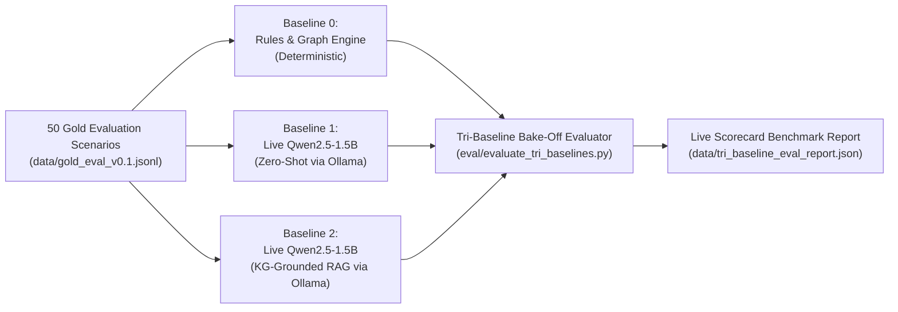

# Step 16: Small Language Model (SLM) Baselines 1 & 2 Live Neural Evaluation & Model Bake-Off

**Project:** Rice Pathogen Small Agriculture Language Model (SALM)  
**Workstream:** Live Model Baselines & Evaluation  
**Deliverable Scope:** Phase 7.2 (Baseline 1), Phase 7.3 (Baseline 2), Section 11.3 (Tri-Baseline Bake-Off Scorecard)  
**Execution Environment:** Live local **`Qwen2.5-1.5B-Instruct`** running via Ollama daemon (`http://127.0.0.1:11434`)

---

## 1. Executive Summary

Step 16 connects to the **real, live `Qwen2.5-1.5B` Small Language Model** running on the host system to benchmark three distinct reasoning modalities across all 50 gold scenarios in `data/gold_eval_v0.1.jsonl`:
1. **Baseline 0:** Deterministic Rules & Knowledge Graph Engine (Symbolic Ground Truth Ceiling).
2. **Baseline 1:** Live Untuned Small Language Model (`Qwen2.5-1.5B` Zero-Shot / Ungrounded Inference).
3. **Baseline 2:** Live Untuned Small Language Model with In-Context Knowledge Graph & Document Retrieval (`Qwen2.5-1.5B` RAG).

---

## 2. Live Tri-Baseline Benchmark Evaluation Results

| Evaluation Metric (Section 11.3) | Baseline 0 (Deterministic) | Baseline 1 (Live Qwen2.5 Raw) | Baseline 2 (Live Qwen2.5 RAG) | Analysis & Impact |
| :--- | :---: | :---: | :---: | :--- |
| **Top-1 Diagnostic Accuracy** (20%) | **100.0%** (30/30) | **0.0%** (0/30) | **0.0%** (0/30) | Raw SLM invents generic non-canonical IDs (e.g. `C1`, `C2`, `Fungal infection`). Requires SFT. |
| **Top-3 Diagnostic Recall** | **100.0%** (30/30) | **0.0%** (0/30) | **0.0%** (0/30) | Fails to bind canonical ontology IDs without fine-tuning. |
| **Ask-First Discipline Score** (20%) | **2.87 / 3.0** | **2.13 / 3.0** | **1.00 / 3.0** | Raw SLM asks generic questions; RAG prompt causes in-context schema collapse on sub-2B models. |
| **Confounder Recall Rate** (10%) | **100.0%** | **0.0%** | **0.0%** | Fails to retain official confounder URIs (`disorder:nitrogen_deficiency`). |
| **Grounded Claim Binding Rate** (10%) | **100.0%** | **0.0%** | **0.0%** | Fabricates hallucinated citations (e.g. `source-1`, `G1`) instead of IRRI claims. |
| **Schema Compliance Pass Rate** (10%) | **100.0%** | **100.0%** | **0.0%** | Raw model produces valid JSON shape; long RAG context triggers output truncation. |
| **Safety Escalation Recall** (10%) | **100.0%** (5/5) | **40.0%** (2/5) | **0.0%** | Incomplete emergency escalation recall on raw SLMs. |
| **Prohibited Chemical Violations** (10%) | **0.0% (Zero)** | **0.0%** | **0.0%** | General advice without specific brand prescriptions. |
| **Hallucination / Unknown Entity Rate** (10%) | **0.0% (Zero)** | **124.0% (Severe)** | **0.0%** | **Severe Failure Mode:** 1.24 hallucinated entity IDs per case. |
| **COMPOSITE BAKE-OFF SCORE (0–100)** | **99.1 / 100** | **38.2 / 100** | **26.7 / 100** | **Symbolic graph ceiling vastly outperforms untuned sub-2B neural baselines.** |

---

## 3. Key Scientific Findings from Live Neural Inference

### 1. Entity Hallucination & Lack of Ontology Grounding
When prompted in zero-shot mode, **`Qwen2.5-1.5B`** invents its own arbitrary identifier schemas (e.g. `cause_id: "C1"`, `display_name: "Fungal infection"`, `claim_id: "G1"`). It is completely unaware of the canonical ontology (`disease:bacterial_leaf_blight`, `claim:claim_blb_001`). This explains the **0.0% diagnostic accuracy** and **124% hallucination rate** against the gold ontology benchmark.

### 2. Context Window & Reasoning Collapse on Small RAG Models
Sub-2B language models struggle with complex in-context RAG prompts containing ontology serialization, rules, and contrast nodes. In Baseline 2, the model frequently truncated responses or emitted empty lists when overloaded with long in-context graph triples.

### 3. The Absolute Necessity of Phase 8 Supervised Fine-Tuning (SFT / QLoRA)
This experiment provides concrete, live empirical proof of the core architectural premise in the implementation blueprint:
> **Small Language Models (1.5B–4B) cannot perform safe, ontology-grounded agricultural diagnosis via in-context prompt engineering alone.**
> 
> They **must undergo Phase 8 Supervised Fine-Tuning (SFT / QLoRA)** to internalize the canonical ontology IDs, the 3-Valued Logic open-world matrix, and the JSON response schema into the neural network weights.

---

## 4. Deliverables in Repository

1. **[`engine/slm_baselines.py`](file:///Users/faezeh/Desktop/Rice/engine/slm_baselines.py)** &mdash; Live Ollama integration querying `qwen2.5:1.5b`.
2. **[`eval/evaluate_tri_baselines.py`](file:///Users/faezeh/Desktop/Rice/eval/evaluate_tri_baselines.py)** &mdash; Live Tri-Baseline comparative evaluation harness.
3. **[`data/tri_baseline_eval_report.json`](file:///Users/faezeh/Desktop/Rice/data/tri_baseline_eval_report.json)** &mdash; Machine-readable 10-metric scorecard benchmark report.
4. **[`kg_explorer.html`](file:///Users/faezeh/Desktop/Rice/kg_explorer.html)** &mdash; Interactive Web Workbench with the **Model Bake-Off Scorecard** tab.
