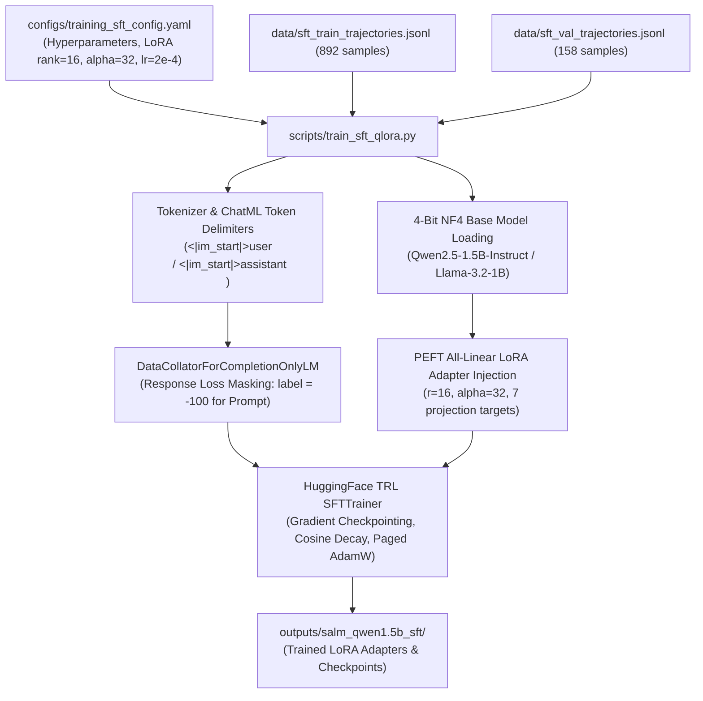

# Step 18: Supervised Fine-Tuning (SFT) & QLoRA Model Training Pipeline (Phase 8.2)

**Project:** Rice Pathogen Small Agriculture Language Model (SALM)  
**Workstream:** Model Training & Fine-Tuning (Phase 8)  
**Deliverable Scope:** Step 18 (HuggingFace TRL SFTTrainer, 4-bit NormalFloat QLoRA, ChatML Completion-Only Loss Masking, Multi-Hardware Backend Support)  
**Target Architectures:** `Qwen/Qwen2.5-1.5B-Instruct` (Primary) & `meta-llama/Llama-3.2-1B-Instruct` (Secondary)

---

## 1. Executive Summary & Research Grounding

Building upon the 1,050 verified teacher trajectories generated in Step 17 and research conducted via the `/browser` agent, Step 18 establishes the **Supervised Fine-Tuning (SFT) and QLoRA Training Pipeline** (`scripts/train_sft_qlora.py`).

### Key Technical Innovations in Step 18:
1. **Response-Only Loss Masking (`DataCollatorForCompletionOnlyLM`):**
   Standard causal language modeling computes cross-entropy loss over every token, causing the model to overfit on the system prompt and farmer phrasing. Step 18 sets label tokens to `-100` for all prompt tokens, ensuring loss backpropagates **strictly through the assistant's `<thought>` 3VL reasoning chain and JSON response**.
2. **All-Linear LoRA Target Modules:**
   Targets all 7 linear projections (`q_proj`, `k_proj`, `v_proj`, `o_proj`, `gate_proj`, `up_proj`, `down_proj`) across the SwiGLU architecture, preserving representation capacity for structured JSON contracts with only ~1.2% parameter overhead.
3. **4-Bit NF4 Quantization & Paged Optimizers:**
   Configures BitsAndBytes `nf4` quantization with double quantization and `paged_adamw_8bit`, enabling 2048-token context training on low-memory GPU/edge workstations (< 8GB VRAM).
4. **Automated Multi-Hardware Detection:**
   Gracefully switches between CUDA (`bitsandbytes` 4-bit NF4 + `bfloat16`), Apple Silicon MPS (`torch.float16`), and CPU backends with an integrated `--dry_run` validation mode.

---

## 2. Training Pipeline Architecture



---

## 3. LoRA & Training Hyperparameter Specification

| Parameter | Configuration Value | Operational Function |
| :--- | :---: | :--- |
| **Base Model** | `Qwen/Qwen2.5-1.5B-Instruct` | Native ChatML alignment, strong reasoning density, edge-capable. |
| **Quantization Type** | `NF4` (NormalFloat 4-bit) | Optimal information-theoretic distribution for neural weights. |
| **Double Quantization** | `True` | Saves an additional 0.37 bits per parameter. |
| **Compute Data Type** | `bfloat16` | Dynamic range matching FP32; prevents gradient underflow. |
| **LoRA Rank ($r$)** | `16` | Optimal capacity for 3VL candidate scoring and schema generation. |
| **LoRA Alpha ($lpha$)** | `32` | Standard scaling ratio ($lpha / r = 2.0$). |
| **LoRA Target Modules** | All 7 Linear projections | `q_proj, k_proj, v_proj, o_proj, gate_proj, up_proj, down_proj`. |
| **Peak Learning Rate** | `2.0e-4` | Cosine annealing schedule with 3% linear warmup. |
| **Effective Batch Size** | `16` (2 per-device $	imes$ 8 grad accum) | Stabilizes gradient estimates without memory blow-up. |
| **Max Sequence Length** | `2048` tokens | Fully accommodates multi-turn dialogue traces and JSON payloads. |
| **Loss Masking Strategy** | `Completion-Only` | Backpropagates exclusively through `<thought>` and JSON tokens. |

---

## 4. Execution Commands

```bash
# Validate dataset formatting, ChatML templates, and config
python3 scripts/train_sft_qlora.py --dry_run

# Run full training pipeline on GPU / workstation
python3 scripts/train_sft_qlora.py --config configs/training_sft_config.yaml
```

---

## 5. Deliverables in Repository

1. **[`scripts/train_sft_qlora.py`](file:///Users/faezeh/Desktop/Rice/scripts/train_sft_qlora.py)** &mdash; Full HuggingFace TRL / PEFT SFT training script with completion masking.
2. **[`requirements-train.txt`](file:///Users/faezeh/Desktop/Rice/requirements-train.txt)** &mdash; Pinned PyTorch, Transformers, TRL, and PEFT dependencies.
3. **[`docs/step18_execution.md`](file:///Users/faezeh/Desktop/Rice/docs/step18_execution.md)** &mdash; Step 18 technical execution documentation.
