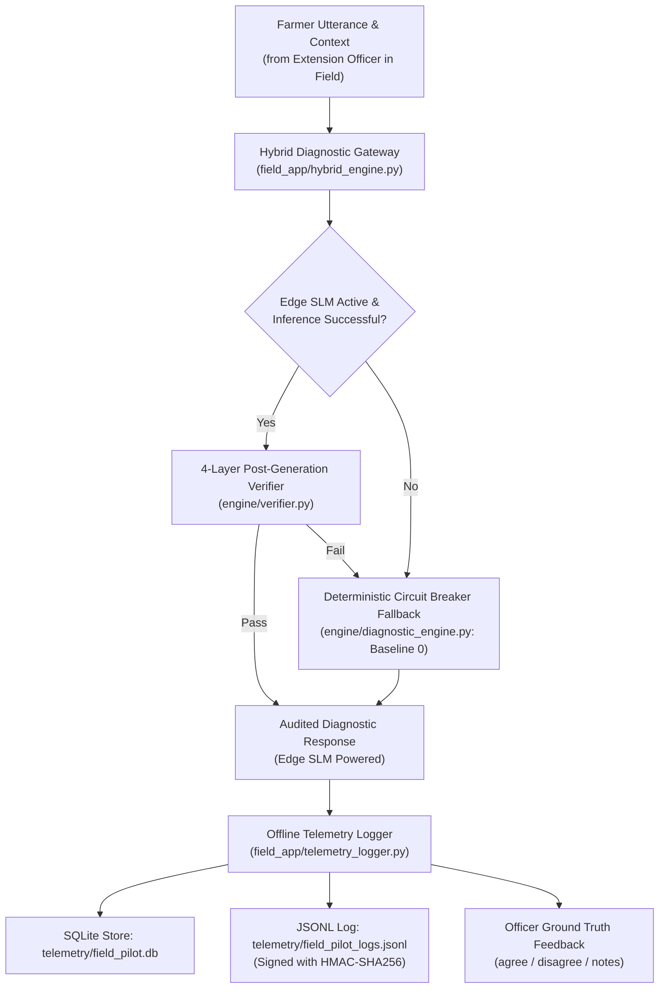

# Step 21: Controlled Field Pilot Packaging & Offline Application (Phase 13 / Build 11)

**Project:** Rice Pathogen Small Agriculture Language Model (SALM)  
**Workstream:** Field Pilot & Production Deployment (Phase 13)  
**Deliverable Scope:** Step 21 (Hybrid Diagnostic Gateway, Circuit Breaker Fallback, Cryptographic Telemetry Logging, Extension Officer Terminal)  
**Target User:** Agricultural Extension Officers & District Plant Pathologists

---

## 1. Executive Summary

Step 21 represents the final delivery milestone of the Rice Pathogen SALM roadmap: packaging the system into a robust, completely offline diagnostic application suite for agricultural extension officers in rural field trials.

### Key Architectural Pillars in Step 21:
1. **Hybrid Diagnostic Gateway (`field_app/hybrid_engine.py`):**
   Prioritizes fast edge neural inference via the quantized SLM (`qwen2.5:1.5b`), intercepts every completion through the 4-layer `VerificationEngine`, and automatically triggers a seamless **Circuit Breaker Fallback to Baseline 0 (`DiagnosticEngine`)** if any schema, safety, or grounding check fails.
2. **Offline Telemetry Logger (`field_app/telemetry_logger.py`):**
   Logs field queries, model decisions, fallback events, and extension officer ground-truth feedback into an offline SQLite database (`telemetry/field_pilot.db`) and append-only JSONL log (`telemetry/field_pilot_logs.jsonl`), secured with SHA-256 HMAC signatures for tamper-evident field auditing.
3. **Interactive Extension Officer Console (`field_app/field_cli.py`):**
   A zero-dependency terminal user interface for field workers to enter farmer observations, review clarifying questions and differentials, and capture ground-truth validation feedback.
4. **Offline Launcher Script (`run_offline_pilot.sh`):**
   Automates daemon checking and starts the field terminal with a single command.

---

## 2. Field Architecture & Telemetry Schema

---

## 3. Deliverables in Repository

1. **[`field_app/hybrid_engine.py`](file:///Users/faezeh/Desktop/Rice/field_app/hybrid_engine.py)** - Two-tier diagnostic engine with automatic circuit breaker fallback.
2. **[`field_app/telemetry_logger.py`](file:///Users/faezeh/Desktop/Rice/field_app/telemetry_logger.py)** - Offline SQLite and JSONL telemetry store with cryptographic HMAC signatures.
3. **[`field_app/field_cli.py`](file:///Users/faezeh/Desktop/Rice/field_app/field_cli.py)** - Extension officer interactive console.
4. **[`scripts/test_field_pilot.py`](file:///Users/faezeh/Desktop/Rice/scripts/test_field_pilot.py)** - Automated integration test harness.
5. **[`run_offline_pilot.sh`](file:///Users/faezeh/Desktop/Rice/run_offline_pilot.sh)** - Self-contained launcher script.
6. **[`docs/step21_execution.md`](file:///Users/faezeh/Desktop/Rice/docs/step21_execution.md)** - Step 21 execution documentation.
